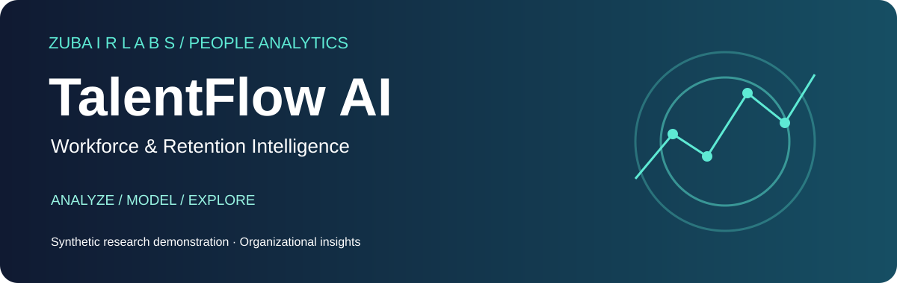
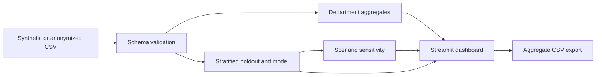

# TalentFlow AI
**Workforce analytics & retention intelligence | ZubairLabs**

  

Explore workforce patterns at department level, compare hypothetical scenarios and evaluate a reproducible logistic regression baseline. No paid API required.

## Architecture

## Features
| Module | Purpose |
|---|---|
| Overview | Turnover, engagement and hours by department |
| Scenario lab | Explore model sensitivity to hypothetical changes |
| Evaluation | ROC-AUC, average precision and confusion matrix |
| Export | Aggregated reports and synthetic sample |

## Quick start
```bash
python -m pip install -r requirements.txt
python -m pytest -q
streamlit run app.py
```
## Data contract
CSV columns: department, tenure_years, weekly_hours, engagement (1–5), training_hours, promotion_wait_years, left (0/1). At least 100 rows and 10 records per outcome. Synthetic data is generated with a fixed seed. Do not upload personal identifiers or sensitive personnel records to a public demo.

## Methodology and limitations
Logistic regression uses one-hot department encoding and a stratified 25% holdout. Metrics are calculated at runtime. Synthetic labels are generated from an artificial probability function; results are not evidence of real-world predictive accuracy. Random holdout is not temporal validation. Scenario changes are not causal estimates. No individual scores are exposed, and department summaries suppress groups below 10 records. This is not an employment screening, termination, or promotion tool. Small-group suppression alone does not guarantee privacy. Uploaded datasets are processed in session memory; do not use confidential data on public hosting.

## Deployment
Deploy app.py from the repository root on Streamlit Community Cloud using Python 3.11. CI runs pytest. Add the verified live URL and genuine screenshots after browser testing.

## Structure
- app.py — interface
- core.py — data, model and aggregate analysis
- tests/ — automated tests
- assets/ — original SVG artwork
- .github/workflows/ — CI

## Roadmap
Temporal validation, subgroup evaluation, uncertainty analysis and privacy review before any real-world organizational use.

[ZubairLabs](https://zubairlabs.com) · [GitHub](https://github.com/muhammadzubair-data)
