<p align="center">
  
</p>

<h1 align="center">TalentFlow AI</h1>
<p align="center"><b>Workforce analytics &amp; employee retention intelligence</b> · a <a href="https://zubairlabs.com">ZubairLabs</a> portfolio project</p>

<p align="center">
  <a href="https://github.com/muhammadzubair-data/talentflow-ai-workforce-retention-intelligence/actions/workflows/ci.yml"></a>
  
  
  
  
  
  
  
</p>

<p align="center"><i>Live demo: the link and badge are added here after the deployed app has been verified in a browser.</i></p>

> [!IMPORTANT]
> TalentFlow AI runs on **synthetic** data by default. Its model metrics show that the method works end to end; they are
> **not** evidence of real-world turnover prediction accuracy. The app is built for aggregate, exploratory insight and
> must not be used for hiring, firing, promotion, pay or any other decision about an individual.

---

## Contents
1. [Executive overview](#1-executive-overview)
2. [Business problem and solution](#2-business-problem-and-solution)
3. [Features](#3-features)
4. [System architecture](#4-system-architecture)
5. [Data processing workflow](#5-data-processing-workflow)
6. [Machine-learning methodology](#6-machine-learning-methodology)
7. [Dataset documentation](#7-dataset-documentation)
8. [Technology stack](#8-technology-stack)
9. [Dashboard screenshots](#9-dashboard-screenshots)
10. [Model evaluation results](#10-model-evaluation-results)
11. [Installation and quick start](#11-installation-and-quick-start)
12. [Project structure](#12-project-structure)
13. [Testing and CI](#13-testing-and-ci)
14. [Deployment](#14-deployment)
15. [Responsible AI and privacy](#15-responsible-ai-and-privacy)
16. [Known limitations](#16-known-limitations)
17. [Roadmap](#17-roadmap)
18. [Author](#18-author)

---

## 1. Executive overview

TalentFlow AI is a Streamlit people-analytics application with seven modules. It shows where turnover concentrates,
how it moves with workload, engagement and development, and how a transparent logistic regression behaves under
hypothetical organisational changes, **all at the level of groups, never individuals**.

| | |
|:--|:--|
| **What it does** | Turnover and retention trends, department comparisons, engagement analysis, what-if scenarios, verified model evaluation, CSV validation and aggregate exports |
| **Model** | Logistic regression (one-hot department + standardised numeric inputs), compared against three baselines on the same holdout |
| **Privacy** | Every chart, table and download hides groups under 10 records; uploads live only in the browser session; protected characteristics are ignored |
| **Holdout result (synthetic)** | ROC-AUC **0.792**, average precision **0.555** (base rate 0.218), F1 **0.530** at a threshold chosen on training data |
| **Quality** | 59 pytest tests (including the original 6), a Playwright browser test, and GitHub Actions on Python 3.11 and 3.12 |
| **Cost** | Free, open-source stack; no paid APIs |

## 2. Business problem and solution

**Problem.** HR and operations leaders want to know *where* retention is weakest and *which working conditions move with
it*. The usual answer, a ranked list of "flight-risk" employees, creates privacy, fairness and trust problems, and the
risk scores are rarely validated honestly.

**Solution.** TalentFlow AI answers the organisational question instead:

- **Where?** Turnover by department, tenure band and year, with 95% Wilson intervals so noise is visible.
- **With what?** Turnover across bands of engagement, weekly hours, training and promotion wait, plus model odds ratios.
- **What if?** Average model score under hypothetical changes for the whole organisation or chosen departments, clearly labelled as associations, not causal effects.
- **How good is the model, really?** A holdout evaluation against simple baselines, with calibration, threshold trade-offs and a time-ordered check.

<p align="center">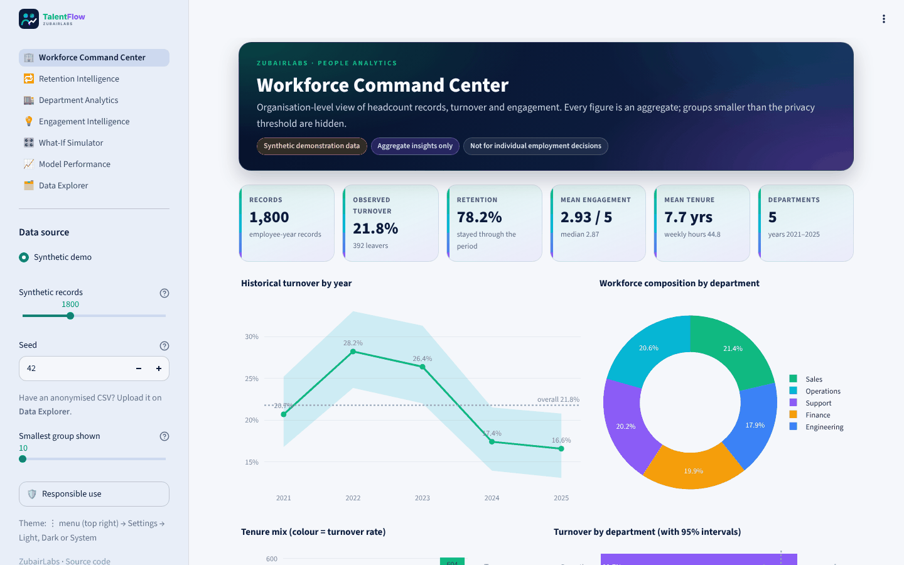</p>
<p align="center"><sub>Real screenshot · Workforce Command Center · light theme · synthetic demo data</sub></p>

## 3. Features

| Module | What you get |
|:--|:--|
| 🏢 **Workforce Command Center** | Six KPI cards (records, turnover, retention, engagement, tenure, departments); yearly turnover with a 95% band; department composition; tenure mix coloured by turnover; auto-generated "what stands out" notes that say when a gap may be noise |
| 🔁 **Retention Intelligence** | Retention by tenure band; turnover trend by department; risk-factor charts for engagement, hours, training and promotion wait; standardised odds ratios from the model |
| 🏬 **Department Analytics** | Department table with share, turnover, intervals, gap vs organisation, workload and development averages, and mean model score as a calibration check; weekly-hours mix; side-by-side profiles |
| 💡 **Engagement Intelligence** | Engagement distribution vs turnover; department hours-vs-engagement map; any two factors as a turnover heatmap (small cells hidden); low-engagement share; hours × engagement interaction |
| 🎛️ **What-If Simulator** | Shift hours, engagement, training and promotion wait for all or selected departments; department-level before/after; sensitivity curves; CSV export |
| 📈 **Model Performance** | Holdout KPIs, five-way model comparison, ROC and PR curves, threshold explorer with live confusion matrix, permutation importance, calibration, class imbalance, time-ordered check, methodology notes, JSON export |
| 🗂️ **Data Explorer** | Anonymised CSV upload with a validation report, data contract and template; filters by department, tenure and year; aggregate column profile; outcome-split histogram; four aggregate downloads |

Also included:
- light and dark themes
- ZubairLabs branding
- a privacy-threshold control that can only be raised
- friendly empty and error states
- a command-line report script (`scripts/evaluate.py`)

## 4. System architecture

<p align="center">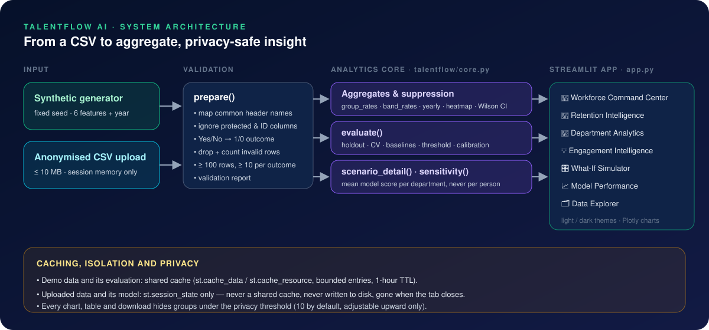</p>

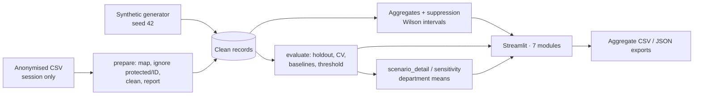

## 5. Data processing workflow

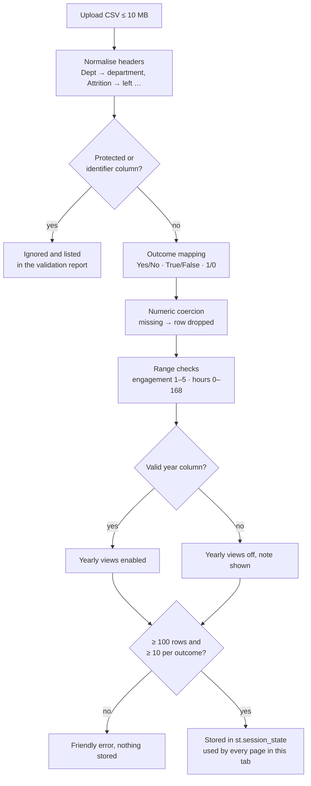

The included `sample_data/messy_upload_example.csv` exercises every branch. It has renamed headers, a synthetic
`Gender`/`Age` pair, an `EmployeeID`, missing values, out-of-range hours, unrecognised labels and a five-person
department.
- **Result:** 1,187 of 1,200 rows are kept. Gender and Age are excluded, and EmployeeID is ignored.
- **Small group:** the five-person department is hidden in every summary.

## 6. Machine-learning methodology

<p align="center">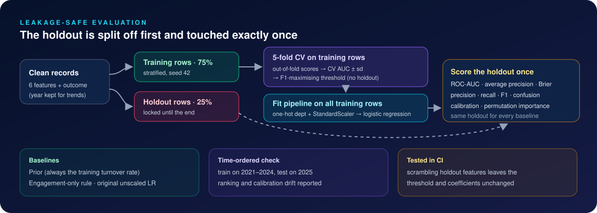</p>

| Step | Choice | Why |
|:--|:--|:--|
| Features | department, tenure, weekly hours, engagement, training hours, years since promotion | Workplace factors only; no protected characteristics |
| Split | Stratified 75/25 holdout, seed 42 | Same split as the original project; reproducible |
| Pipeline | `OneHotEncoder(department)` + `StandardScaler(numeric)` → `LogisticRegression(C=1, max_iter=2000)` | Encoding and scaling are fitted inside the pipeline on training rows only, which also makes coefficients comparable |
| Cross-validation | 5-fold stratified on training rows | Stability (AUC ± sd) and out-of-fold scores |
| Threshold | F1-maximising threshold from out-of-fold training scores | Chosen without the holdout; the default 0.5 catches only 32% of leavers at a 22% base rate |
| Baselines | Training-rate prior; engagement-only rule; the original unscaled pipeline; a class-balanced variant | A model is only interesting relative to simple alternatives |
| Imbalance | 392 leavers vs 1,408 stayers (1 : 3.6) | Reported; average precision and recall used instead of accuracy |
| Importance | Permutation importance (20 repeats, holdout AUC) + odds ratio per 1 SD | Aggregate, model-level; never per person |
| Calibration | Holdout deciles and Brier score | Scenario averages rely on calibrated probabilities |
| Time check | Train 2021–2024, test 2025 | Shows ranking holding while calibration drifts |

The holdout is **scored once**. A CI test scrambles holdout features and confirms the threshold and coefficients do
not change. Every metric in the app is computed at runtime; nothing is hard-coded.

## 7. Dataset documentation

**Synthetic generator** (`talentflow.core.generate`, default 1,800 employee-year records, seed 42):

| Column | Type | Range | Notes |
|:--|:--|:--|:--|
| `department` | category | Operations, Engineering, Sales, Support, Finance | uniform |
| `tenure_years` | float | 0.2–15 | uniform |
| `weekly_hours` | float | 30–60 | uniform |
| `engagement` | float | 1–5 | uniform |
| `training_hours` | float | 0–80 | uniform |
| `promotion_wait_years` | float | 0–8 | uniform |
| `left` | 0/1 | 21.8% = 1 | Bernoulli draw from a fixed logistic formula: more hours and longer promotion wait raise the odds; engagement, training and tenure lower them; department has no effect |
| `year` | int | 2021–2025 | **new**, from a separate random stream, so the six original features and the label are identical to the original project (tested) |

Features are drawn **independently**, which real workforces never are; the app says so where it matters. The
generator's formula is known, so the "true" drivers can be checked against what the model recovers (it recovers all
five directions and finds department ≈ 0).

**Upload contract:** the seven columns above (`year` optional). Common names are mapped automatically. At least 100
valid rows and at least 10 leavers and 10 stayers are needed, with up to 50 departments and 200,000 rows. Do not
upload names, IDs or other personal data.

## 8. Technology stack

| Layer | Tools |
|:--|:--|
| App | Streamlit (`st.navigation` multipage, custom CSS, light/dark `config.toml` themes) |
| Data | pandas, NumPy |
| ML | scikit-learn: `LogisticRegression`, `ColumnTransformer`, `StratifiedKFold`, `permutation_importance` |
| Charts | Plotly Express / Graph Objects |
| Testing | pytest, Streamlit `AppTest`, Playwright (Chromium) |
| CI | GitHub Actions (Python 3.11 and 3.12, plus browser job) |
| Hosting | Streamlit Community Cloud (free tier) |

## 9. Dashboard screenshots

All images below are **real screenshots** of the running app. The illustrations in sections 4 and 6 are
hand-made diagrams, not screenshots.

| | |
|:--:|:--:|
| 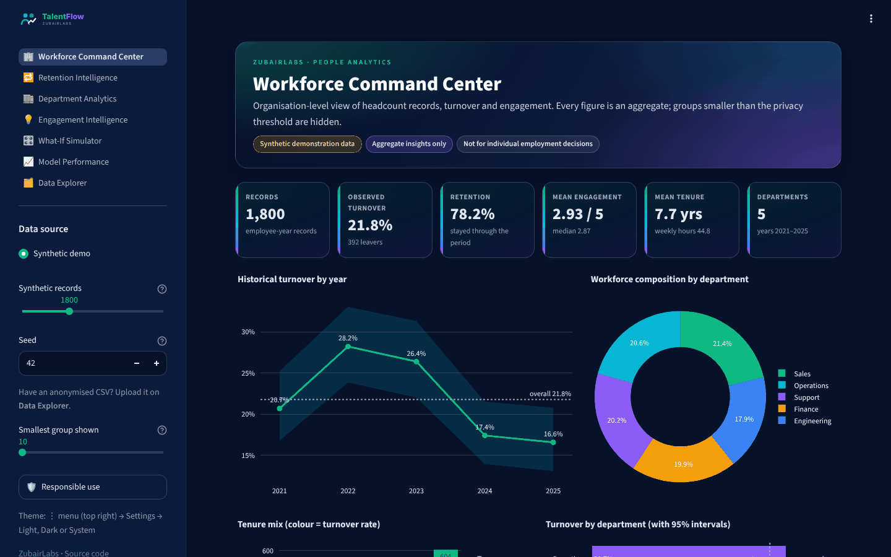 | 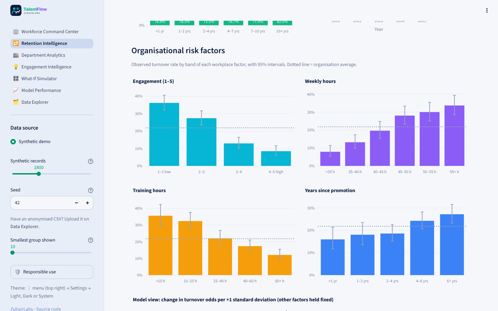 |
| Workforce Command Center · dark | Retention Intelligence · risk factors |
| 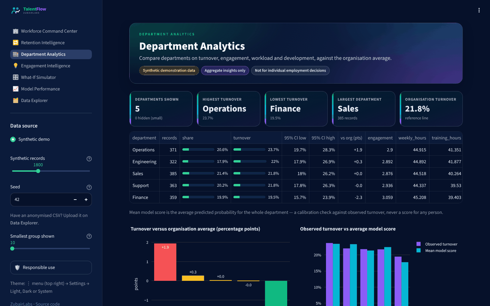 | 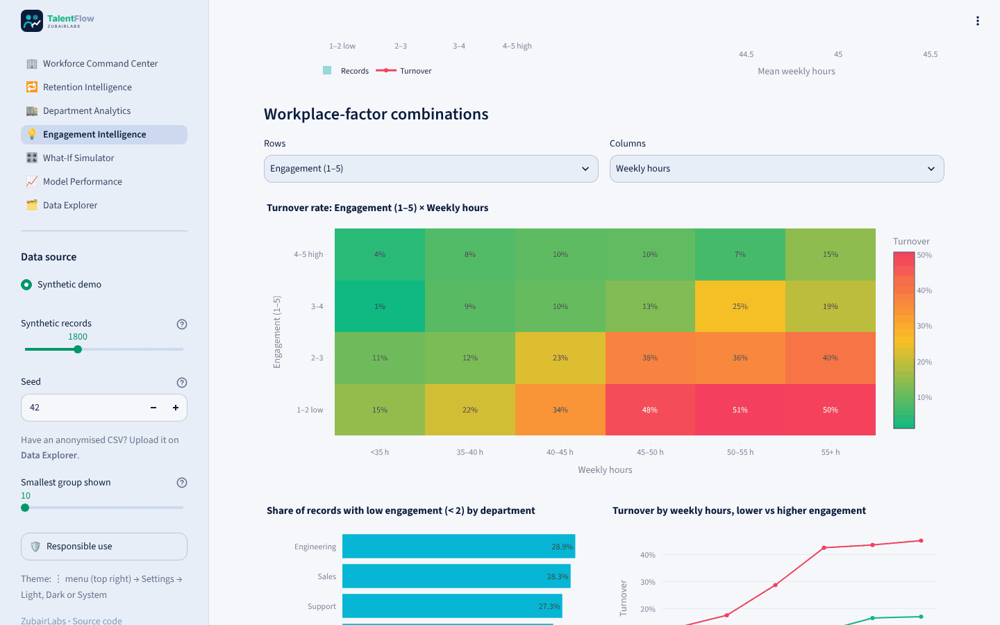 |
| Department Analytics · dark | Engagement Intelligence · factor heatmap |
| 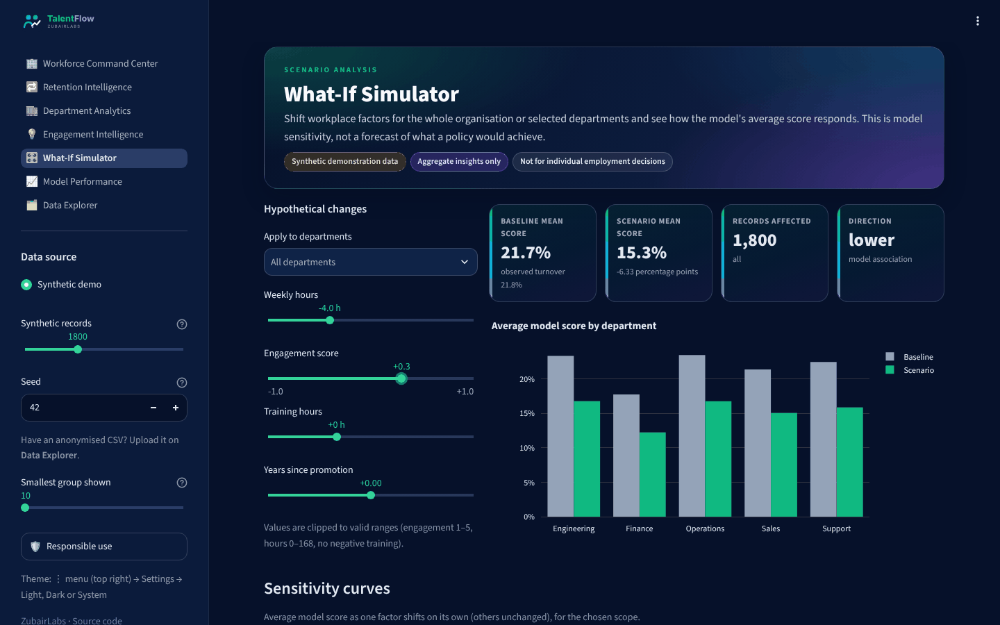 | 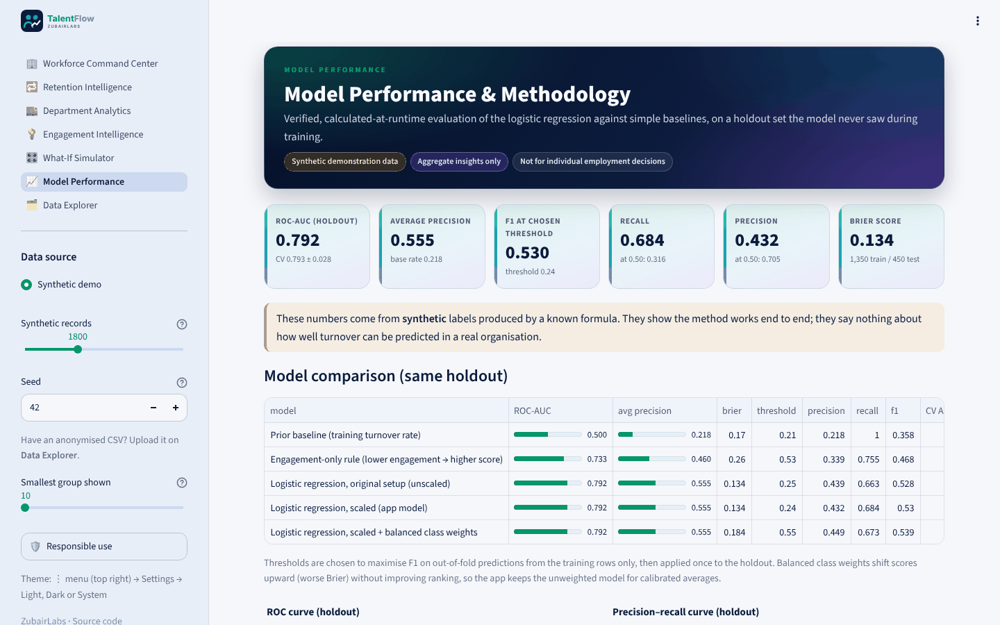 |
| What-If Simulator · hours −4, engagement +0.3 | Model Performance · KPIs and comparison |
| 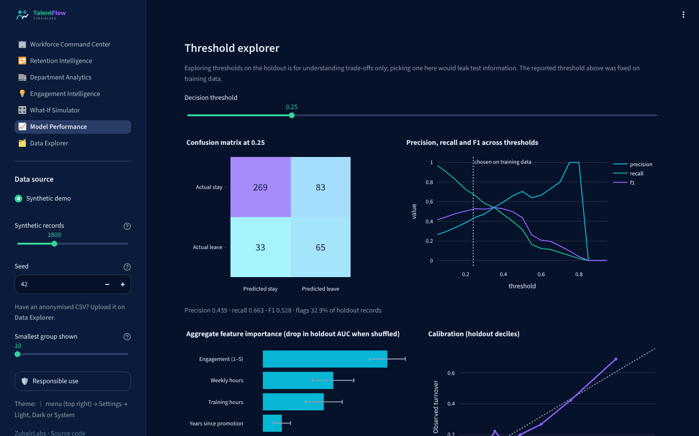 | 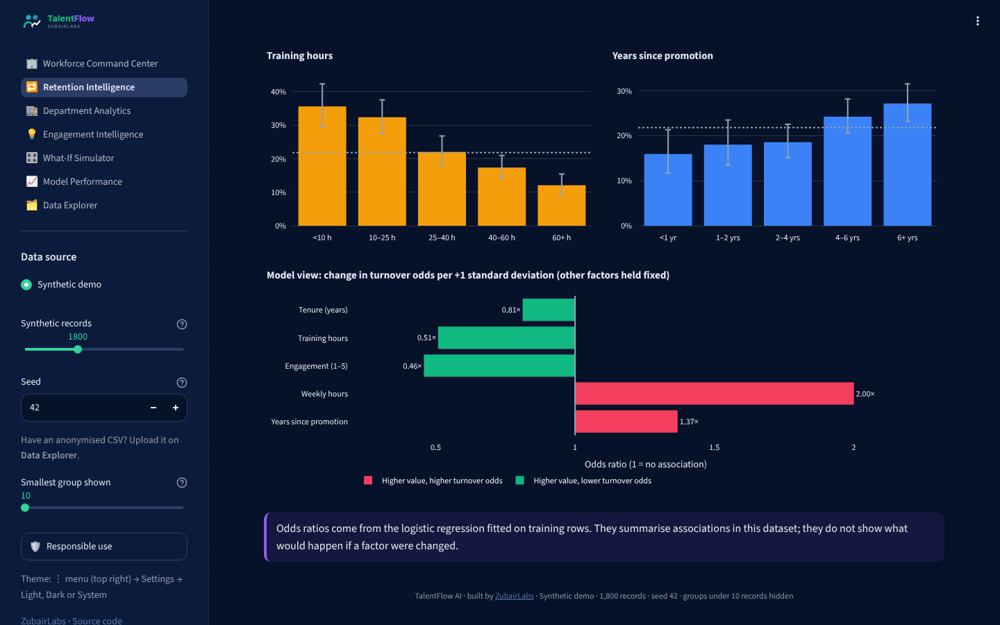 |
| Threshold explorer and importance | Model odds ratios per standard deviation |
| 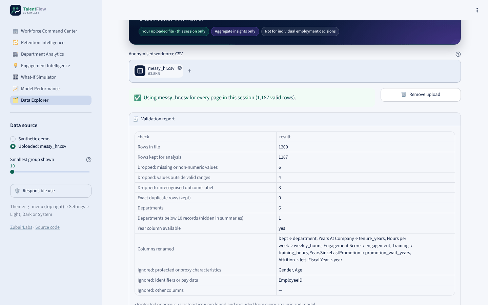 | 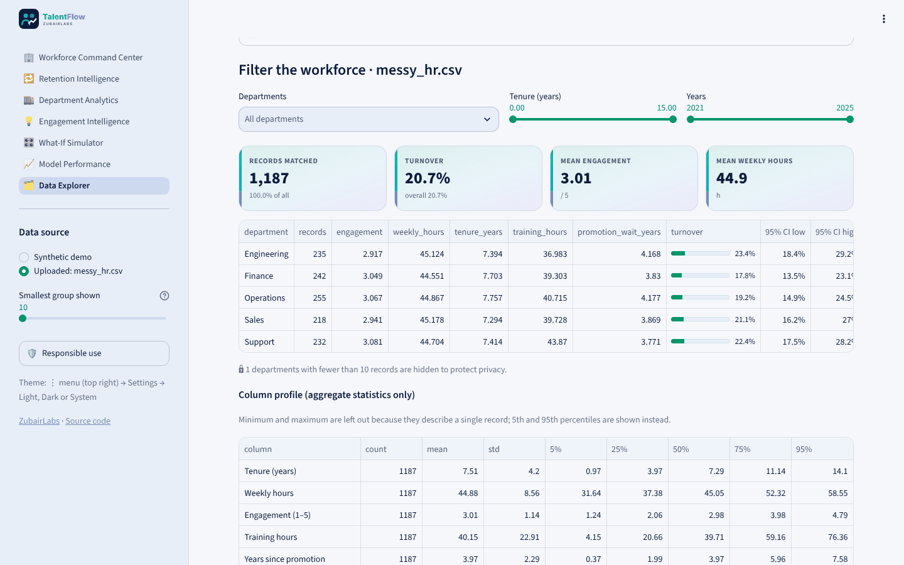 |
| Messy upload · validation report | Data Explorer · aggregate profile |

## 10. Model evaluation results

Synthetic data, default settings (1,800 records, seed 42), 1,350 training / 450 holdout rows. The numbers are
reproduced by `python scripts/evaluate.py` and by CI, and are identical under the pinned dependency versions used for
deployment.

| Model (same holdout) | ROC-AUC | Avg precision | Brier | Threshold | Precision | Recall | F1 | CV AUC (train) |
|:--|--:|--:|--:|--:|--:|--:|--:|--:|
| Prior baseline (training turnover rate) | 0.500 | 0.218 | 0.170 | 0.21 | 0.218 | 1.000 | 0.358 | 0.500 |
| Engagement-only rule | 0.733 | 0.460 | 0.260 | 0.53 | 0.339 | 0.755 | 0.468 | 0.676 ± 0.031 |
| Logistic regression, original setup (unscaled) | 0.792 | 0.555 | 0.134 | 0.25 | 0.439 | 0.663 | 0.528 | 0.793 ± 0.028 |
| **Logistic regression, scaled (app model)** | **0.792** | **0.555** | **0.134** | **0.24** | **0.432** | **0.684** | **0.530** | **0.793 ± 0.028** |
| Logistic regression, balanced class weights | 0.792 | 0.555 | 0.184 | 0.55 | 0.449 | 0.673 | 0.539 | 0.792 ± 0.026 |

**Reading the table**
- **Ranking:** the model clearly beats the baselines (AUC +0.06 over the engagement rule; average precision 2.5× the base rate).
- **Scaling** changes ranking very little but makes coefficients comparable.
- **Balanced weights** don't improve ranking and inflate probabilities (Brier 0.184), so the app keeps the unweighted model for calibrated averages.
- **Threshold:** the original app classified at 0.5, which gives precision 0.705, recall **0.316** and F1 0.437 (31 of 98 leavers found). The training-chosen threshold of 0.24 finds 67 of 98 (recall **0.684**, F1 **0.530**) at the cost of more false alarms.
- **Confusion matrix at 0.24:** TN 264 · FP 88 · FN 31 · TP 67.
- **Permutation importance** (holdout AUC drop):

  | Feature | AUC drop |
  |:--|--:|
  | Engagement | 0.123 |
  | Weekly hours | 0.070 |
  | Training hours | 0.060 |
  | Promotion wait | 0.019 |
  | Tenure | 0.008 |
  | Department | −0.003 |

- **Odds ratio per +1 SD:**

  | Feature | Odds ratio |
  |:--|--:|
  | Weekly hours | 2.00× |
  | Promotion wait | 1.37× |
  | Tenure | 0.81× |
  | Training | 0.51× |
  | Engagement | 0.46× |

- **Time-ordered check (train 2021–2024 → test 2025):** ROC-AUC 0.804 (engagement rule 0.681). The ranking holds, but the mean score is 21.9% against 16.6% observed. That is the calibration drift a real deployment would need to monitor.
- **Scenario examples (associations, not effects):**
  - Engagement +0.5 for everyone moves the mean score from 21.7% to 17.4%.
  - Hours −4 with engagement +0.3 moves it to 15.3%.
  - Engagement +1 in Sales only moves Sales from 21.4% to 13.8% and leaves the other departments unchanged.

## 11. Installation and quick start

```bash
git clone https://github.com/muhammadzubair-data/talentflow-ai-workforce-retention-intelligence.git
cd talentflow-ai-workforce-retention-intelligence
python -m venv .venv && source .venv/bin/activate      # Windows: .venv\Scripts\activate
pip install -r requirements.txt
streamlit run app.py                                     # http://localhost:8501
```

Command-line report (same validation and metrics as the app):

```bash
python scripts/evaluate.py                                   # synthetic demo
python scripts/evaluate.py --csv sample_data/messy_upload_example.csv
python scripts/evaluate.py --out reports/                    # aggregate CSV + JSON
```

The original API still works: `from core import generate, validate, train, aggregate, scenario`.

## 12. Project structure

```text
talentflow-ai-workforce-retention-intelligence/
├── app.py                      # Streamlit app: 7 modules, theming, session-isolated uploads
├── core.py                     # backward-compatible shim for the original imports
├── talentflow/
│   ├── __init__.py
│   └── core.py                 # data, validation, aggregates, evaluation, scenarios
├── scripts/evaluate.py         # CLI evaluation and aggregate reports
├── tests/
│   ├── test_core.py            # the original 6 tests (unchanged)
│   ├── test_pipeline.py        # 42 tests: data, validation, privacy, leakage, metrics, scenarios
│   ├── test_app.py             # 11 Streamlit AppTest checks
│   └── e2e_ui.py               # Playwright browser test (run in CI)
├── sample_data/
│   ├── synthetic_workforce.csv     # the default 1,800-record demo
│   └── messy_upload_example.csv    # exercises every validation branch
├── assets/                     # hero, logo, icon, diagrams, real screenshots
├── docs/MODEL_CARD.md          # model card and responsible-use notes
├── docs/PORTFOLIO.md           # case study and announcement copy
├── .streamlit/config.toml      # light/dark themes, 10 MB upload limit
├── .github/workflows/ci.yml
├── requirements.txt / requirements-dev.txt
└── README.md
```

## 13. Testing and CI

| Suite | Count | Covers |
|:--|--:|:--|
| `tests/test_core.py` | 6 | The original tests, unchanged |
| `tests/test_pipeline.py` | 42 | Original columns reproduced exactly; validation (strict and forgiving); protected/ID exclusion; Wilson intervals; suppression in groups, heatmaps and profiles; metrics re-computed with scikit-learn; disjoint stratified split; threshold from training only; leakage test; baselines; importance directions; calibration; temporal check; determinism; scenario directions, scope and clipping |
| `tests/test_app.py` | 11 | Every page renders; upload used on every page; the privacy threshold hides a 15-person department at 20; the simulator reacts; the original import shim works |
| `tests/e2e_ui.py` | browser | 7 pages; simulator slider via keyboard; scenario CSV; JSON export matches the KPI; messy upload with validation report; session kept across sidebar navigation; department CSV has no small groups; removing the upload; a bad file shows a clear error |

```bash
pytest -q                                   # 59 passed
pip install -r requirements-dev.txt && python -m playwright install chromium
streamlit run app.py & python tests/e2e_ui.py http://localhost:8501
```

GitHub Actions runs a compile check, pytest and the CLI on Python 3.11 and 3.12, then the Playwright job.

## 14. Deployment

Streamlit Community Cloud (free):

1. Go to [share.streamlit.io](https://share.streamlit.io) → **Create app** → *Deploy a public app from GitHub*.
2. Repository `muhammadzubair-data/talentflow-ai-workforce-retention-intelligence`, branch `main`, main file `app.py`.
3. **Advanced settings → Python 3.12.** No secrets are needed.
4. Deploy. The first visit trains and evaluates the demo model in a few seconds; the result is cached for an hour.

Notes:
- Demo results use `st.cache_data` / `st.cache_resource` with bounded entries.
- Uploaded data and its model are kept only in `st.session_state`, so sessions never share them.
- After pushing changes to `talentflow/core.py`, use **Manage app → Reboot** so the new module is loaded.

## 15. Responsible AI and privacy

| Principle | How it is enforced |
|:--|:--|
| Aggregate only | No page, table or download lists individuals or individual scores; model outputs are averaged per department or organisation |
| Small-group suppression | Groups, bands, heatmap cells and histogram segments under 10 records are hidden; the threshold can be raised to 50 but never lowered; min/max statistics are not shown |
| No protected characteristics | Columns that look like age, gender, ethnicity, religion, marital status, disability, nationality and similar are excluded from every analysis, and the exclusion is listed in the validation report |
| No identifiers or pay | ID, name, email, phone and salary-like columns are ignored |
| Session isolation | Uploads are processed in memory for one browser session, never cached across users or written to disk, and can be removed with one click |
| Honest framing | Synthetic-data banner on every page; scenarios are labelled as associations; thresholds explored on the holdout are marked as exploratory |
| Not a decision tool | No hiring, firing, promotion or pay recommendations are produced or implied |

Small-group suppression lowers re-identification risk but does not guarantee anonymity. Real employee data should
not be uploaded to a public demo; use a private deployment with appropriate governance. See
[`docs/MODEL_CARD.md`](docs/MODEL_CARD.md).

## 16. Known limitations

- Synthetic labels follow a known logistic formula with independent features, so real data will be noisier and correlated.
- The random holdout is not a prospective validation, and the time-ordered check uses synthetic years.
- Logistic regression assumes linear effects on the log-odds; interactions such as hours × engagement are not modelled.
- Scenarios shift inputs uniformly. They ignore confounding, selection and feedback, so they are not causal estimates.
- A fairness audit across demographic groups is out of scope by design; doing one properly needs governed access to protected attributes.
- Wilson intervals are per group, with no correction for multiple comparisons.

## 17. Roadmap

- Survival or time-to-event modelling for tenure-aware retention curves
- Calibration monitoring and recalibration across years
- Optional, governed fairness audit mode (aggregate disparity metrics only)
- Interaction terms and a gradient-boosting comparison with the same honest baselines
- Differential-privacy noise for aggregate exports
- A PDF executive summary export

## 18. Author

**Muhammad Zubair** · ZubairLabs: data analytics, BI dashboards and applied machine learning for startups and SMEs.

- 🌐 [zubairlabs.com](https://zubairlabs.com)
- 💻 [github.com/muhammadzubair-data](https://github.com/muhammadzubair-data)
- 💼 [LinkedIn](https://www.linkedin.com/in/xubbiofficial/)

<sub>Built on synthetic data for demonstration. Not for consequential employment decisions.</sub>
